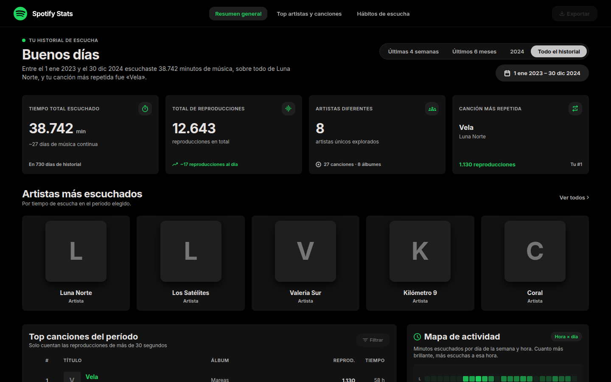
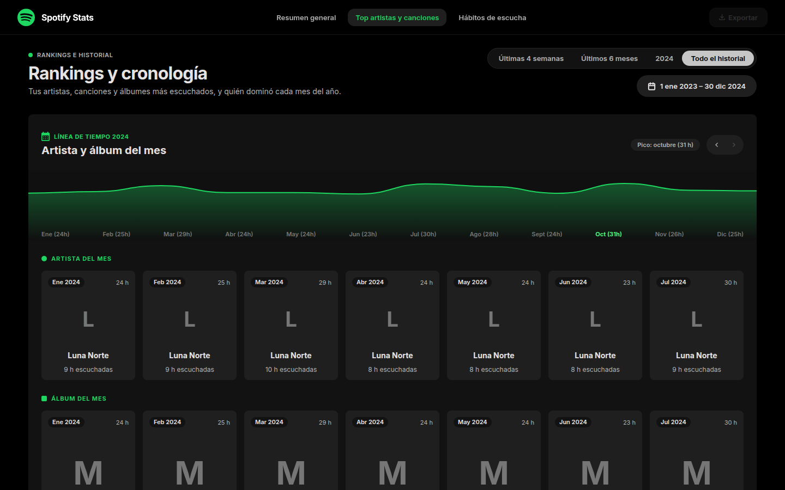
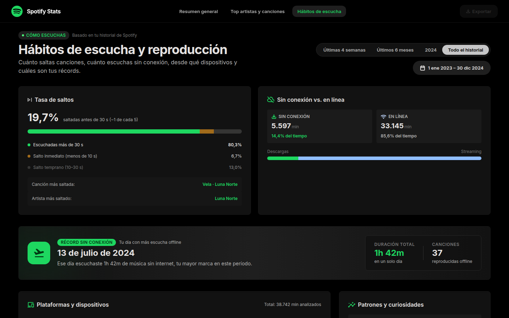
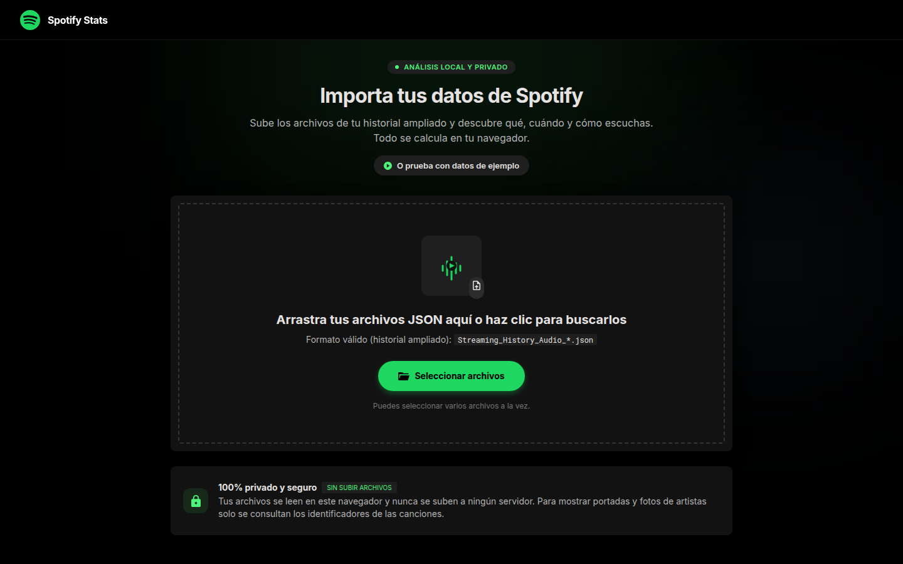

<h1 align="center">Spotify Stats</h1>

<p align="center">
  <em>Tu historial completo de Spotify convertido en estadísticas, sin que tus datos salgan de tu navegador.</em>
</p>

<p align="center">
  
  
  
  
  
</p>

<p align="center">
  <a href="#funciones">Funciones</a> •
  <a href="#consigue-tus-datos">Consigue tus datos</a> •
  <a href="#cómo-está-hecha">Cómo está hecha</a> •
  <a href="#desarrollo">Desarrollo</a> •
  <a href="#despliegue">Despliegue</a>
</p>

<p align="center">
  
  
  
  
</p>

---

**Spotify Stats** lee los archivos del *historial de streaming ampliado* que Spotify entrega a cada usuario y calcula qué, cuándo y cómo escuchas. Todo el cálculo ocurre en el navegador: los archivos nunca se suben a ningún servidor. Lo único que viaja es la lista de canciones de las que se piden portadas e imágenes de artistas.

## Funciones

### 📊 Resumen general

- Tiempo total escuchado, reproducciones, artistas distintos y canción más repetida.
- Artistas más escuchados y top de canciones del período.
- Mapa de actividad por día de la semana y hora.

### 🏆 Top artistas y canciones

- Artista y álbum de cada mes en una línea de tiempo, con el mes pico.
- Top histórico de álbumes, y top 10 de artistas y canciones por tiempo o por reproducciones.

### 🎧 Hábitos de escucha

- Tasa de saltos: saltos inmediatos, tempranos y la canción y el artista más saltados.
- Escucha sin conexión frente a en línea, y tu récord offline.
- Plataformas y dispositivos, patrones y curiosidades.

### 🗓️ Períodos y privacidad

- Todas las pantallas se filtran por las últimas 4 semanas, los últimos 6 meses, un año, todo el historial o un rango propio.
- Varios archivos a la vez; los datos se procesan en el navegador.
- Botón de **datos de ejemplo** para probar la app sin un historial propio.

## Consigue tus datos

1. En la [configuración de privacidad de Spotify](https://www.spotify.com/account/privacy/), pide el **historial de streaming ampliado**.
2. Spotify envía un ZIP por correo, normalmente en unos días (puede tardar hasta 30). Descomprímelo.
3. Arrastra a la app los archivos `Streaming_History_Audio_*.json`.

## Cómo está hecha

| Pieza | Tecnología |
| --- | --- |
| Web | React 19 y TypeScript, empaquetada con Vite |
| Pruebas web | Vitest |
| Servidor de imágenes | Spring Boot 4.1 sobre Java 21 |
| Imágenes | Spotify Web API con *client credentials* |
| Despliegue | Una imagen Docker; Spring Boot sirve la web y la API desde el mismo origen |

La web sigue una estructura por capas:

- `web/src/model/`: el tipo `Play`, una reproducción del historial.
- `web/src/services/`: lectura de los JSON y cálculos (tops, hábitos, saltos, períodos, línea de tiempo). Sin React.
- `web/src/ui/`: pantallas y componentes.

El servidor expone `POST /api/images/albums` y `POST /api/images/artists`, que reciben URIs de canciones y devuelven sus imágenes:

- `controller/`: los endpoints.
- `service/`: busca la imagen de cada canción, álbum o artista.
- `client/`: llamadas a la Spotify Web API.

Sin el servidor la app funciona igual, solo que sin imágenes.

## Desarrollo

**Requisitos:** Node 22 y JDK 21. Para las imágenes, una app en el [panel de desarrolladores de Spotify](https://developer.spotify.com/dashboard) con su *client id* y *client secret*.

Crea `server/.env` (no se sube al repositorio ni entra en la imagen):

```
SPOTIFY_CLIENT_ID=...
SPOTIFY_CLIENT_SECRET=...
```

```bash
# Servidor de imágenes en localhost:8080
cd server && ./mvnw spring-boot:run

# Web en localhost:5173; reenvía /api al servidor
cd web && npm install && npm run dev
```

| Comando | Dónde | Qué hace |
| --- | --- | --- |
| `npm test` | `web/` | Pruebas de servicios y componentes |
| `npm run lint` | `web/` | Lint con oxlint |
| `npm run build` | `web/` | Comprobación de tipos y build de producción |
| `./mvnw test` | `server/` | Pruebas del servidor |

Si la web corre en WSL y el servidor en Windows, activa `networkingMode=mirrored` en `.wslconfig` para que ambos compartan `localhost`.

## Despliegue

### Docker

Una sola imagen lo ejecuta todo: construye la web, la incluye en el jar y Spring Boot la sirve junto a `/api`. Corre como usuario sin privilegios sobre un JRE Alpine.

```bash
docker build -t spotify-stats .
docker run -p 8080:8080 --env-file server/.env spotify-stats
```

Luego abre http://localhost:8080.

### Render

1. New → **Web Service** → conecta este repositorio. Render detecta el `Dockerfile` de la raíz.
2. Añade las variables de entorno `SPOTIFY_CLIENT_ID` y `SPOTIFY_CLIENT_SECRET`.
3. Despliega. Render define `PORT` y el servidor escucha en ese puerto.

En el plan gratuito el servicio se duerme tras 15 minutos sin visitas, así que la primera visita después tarda cerca de un minuto.

## Autor

[**Julian David Bocanegra Segura**](https://github.com/Julian049): producto, diseño y desarrollo.

Spotify Stats no está afiliado a Spotify. Spotify es una marca registrada de Spotify AB.
